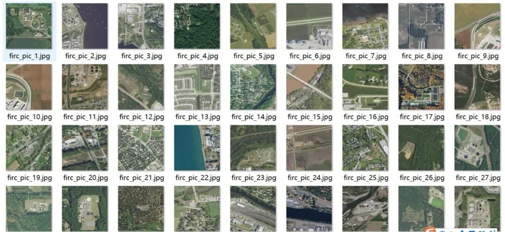
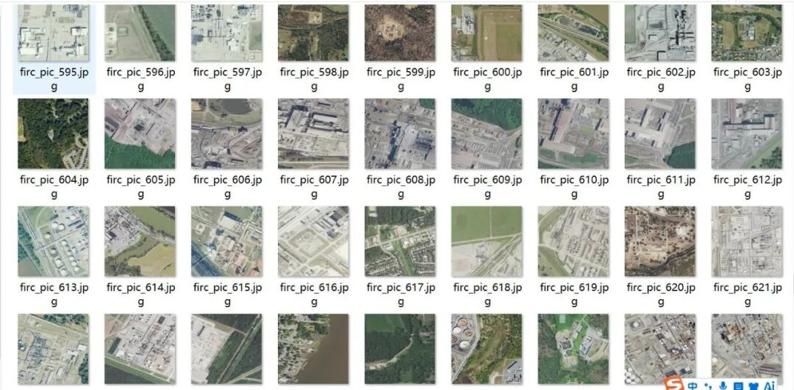
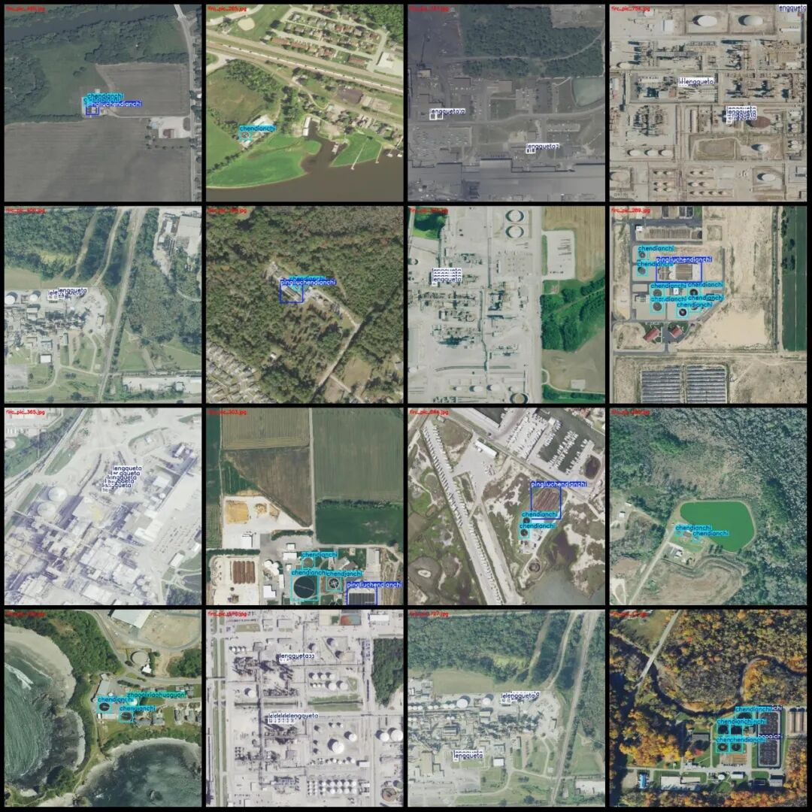
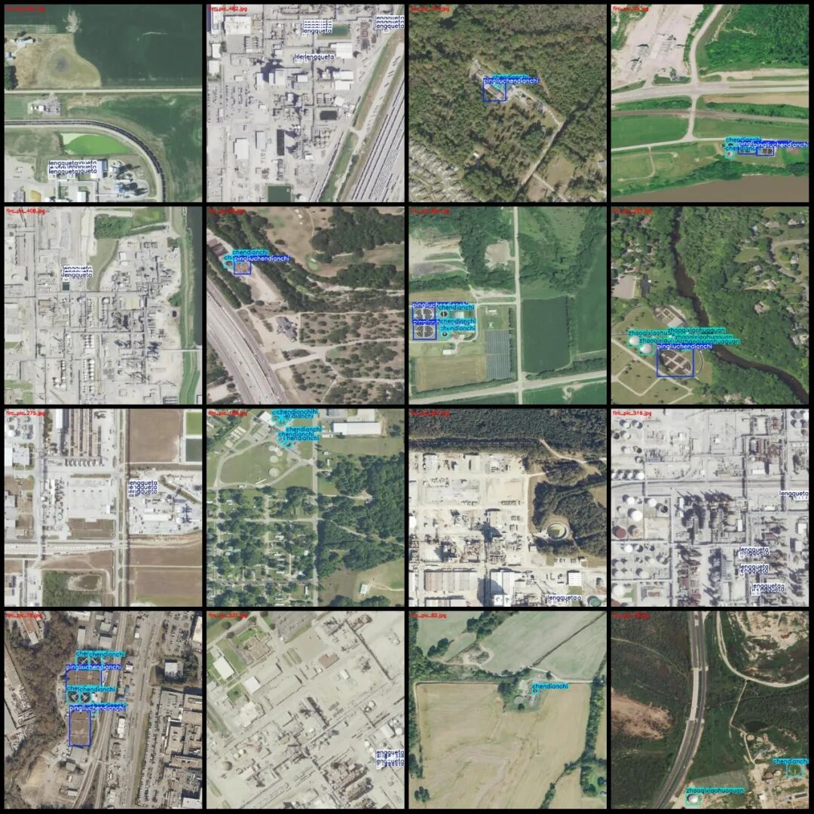
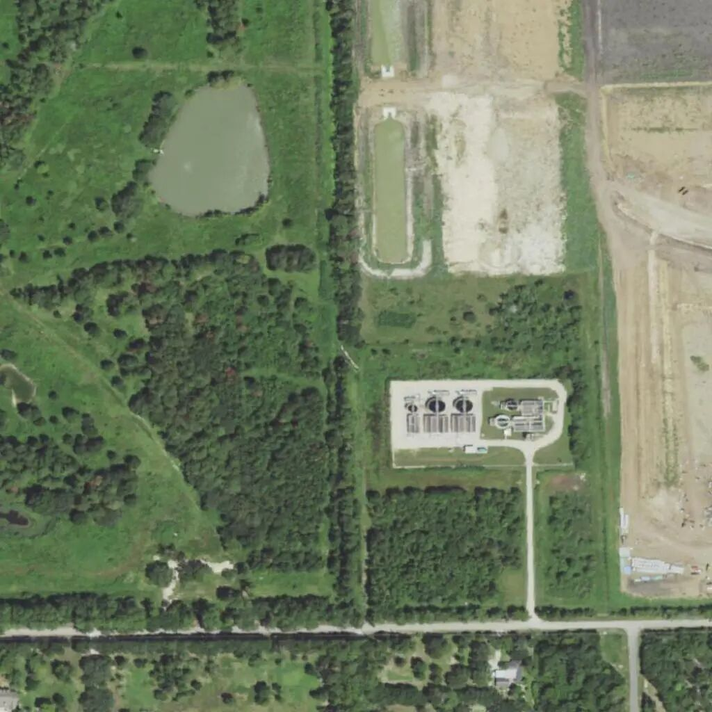

# Remote Sensing Image Water Treatment Facilities Detection Dataset VOC+YOLO format with 849 images in 5 categories

Dataset format: Pascal VOC format + YOLO format (txt file without split path, only containing jpg images and corresponding VOC format xml files and yolo format txt files)

Number of images (number of jpg files): 849

Number of annotations (number of xml files): 849

Number of annotations (number of txt files): 849

Label category count: 5

Label category names (Note that the order of categories in the YOLO format does not correspond to this, but is based on the classes.txt file in the labels folder): ["baoqichi", "chendianchi", "lengqueta", "pingliuchendianchi", "zhaoqixiaohuaguan"]

["Aeration Tank", "Settlement Tank", "Cooling Tower", "Plain Solid Separator", "Biogas Digestion Tank"]

Number of boxes labeled in each category:

Baoqichi Frame Count = 118

Chenchiangchi Frame Count = 1640

lengqueta frame count = 2770

Pingliuchendianchi Frame Count = 148

zhaoqixiaohuaguan Frames = 94

Total frame count: 4770

Number of images per category:

baoqichi occupies the number of images = 83

Chen Dianchi owns 475 images.

Lengueta's possession of images = 356

Pingliuchendianchi occupies = 114

Zhaoqixiaohuaguan occupies a total of 38 images.

Image resolution: 1024x1024

Using labelImg:

Annotation rules: Draw a rectangle around the category.

Important Notice: The dataset does not have separate training, validation, and test sets; you need to partition them yourself.

Special : This dataset does not guarantee the accuracy of the trained models or weight files.

Image Preview:

Annotation example:

Single image:

## Payment

Here is a pay link on Stripe ( https://buy.stripe.com/3cs8yP7sY87d0vu9AB ). Please contact me lonlonago@foxmail.com after funding $89, and I will send you a complete data files , thank you!

